 

  <picture>
    <source media="(prefers-color-scheme: dark)" srcset="./dark.svg">
    <source media="(prefers-color-scheme: light)" srcset="./light.svg">
    
  </picture>

<h1 align="center">Hi there, I'm Nada! 👋</h1>

<h3 align="center">Aspiring Data Analyst | Turning Data into Insights</h3>

  I'm passionate about understanding business problems, exploring data, and turning analytical findings into meaningful insights that support better decisions.

---

## 👩‍💻 About Me

I'm an aspiring Data Analyst currently building my technical and analytical skills.

I believe that data analysis is not just about writing queries or creating dashboards — it's about understanding the business, asking the right questions, and finding insights that make a difference.

## 🛠️ Skills & Tools

**Tools I've Completed:**
- Excel
- SQL
- Power BI
- Tableau

## 📚 Currently Learning

I'm expanding my Data Analytics skills through:

- Python for Data Analysis
- NumPy & Pandas
- Statistics
- Exploratory Data Analysis (EDA)
- Data Visualization
- Data Storytelling
- Business & Analytical Thinking

## 🚀 What I'm Working On

- Building practical Data Analysis projects
- Exploring and analyzing real-world datasets
- Solving business case studies
- Developing my Data Analytics portfolio
- Improving my problem-solving and analytical thinking skills

## 🎯 My Goal

My goal is to become a professional Data Analyst who can:

- Understand business problems and objectives
- Ask the right analytical questions
- Identify relevant KPIs and measure performance
- Analyze data to discover meaningful insights
- Provide actionable, data-driven recommendations
- Communicate findings clearly to support business decisions

## 📈 My Learning Journey

I'm continuously learning, practicing, and building projects to strengthen my technical and analytical abilities.

I'm especially interested in the connection between data analysis and business decision-making.

## 📂 Portfolio

I'm building projects that demonstrate my ability to work with data and solve business problems, including:

- Data Cleaning & Exploration
- SQL Analysis
- Dashboard Development
- Business KPI Analysis
- Data Storytelling
- Data-driven Recommendations

---

  <i>"Analyze → Explain → Recommend"</i>

